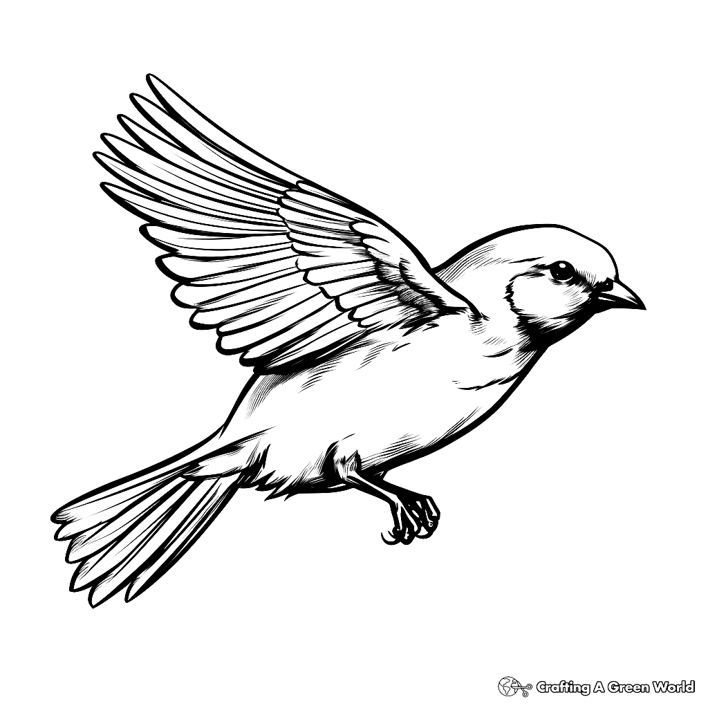
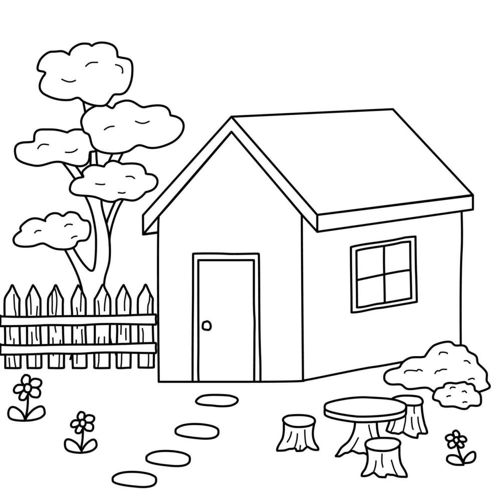

# Sketch to Art Generator

A Generative AI project that transforms sketches into artistic images using Stable Diffusion and ControlNet.

## Technologies Used

- Python
- PyTorch
- Diffusers
- Transformers
- Stable Diffusion
- ControlNet
- Google Colab

## Example 1: Bird

### Input

### Oil Pastel Output

.png)

### Watercolor Output

.png)

## Example 2: House

### Input

### Abstract Output

.png)

### Mosaic Output

.png)

## Author

Bhoomika Vaishali Narayan
